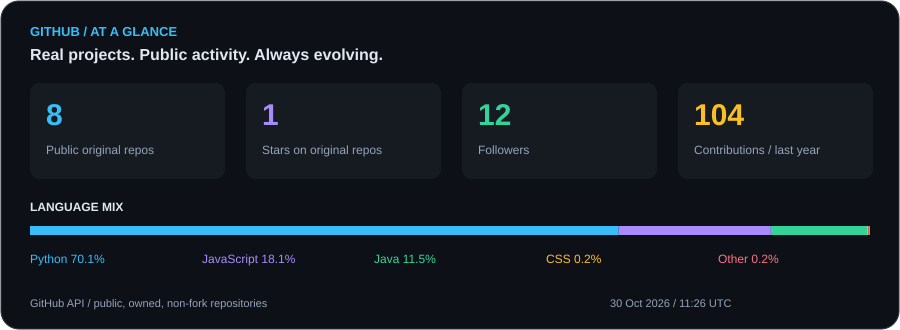
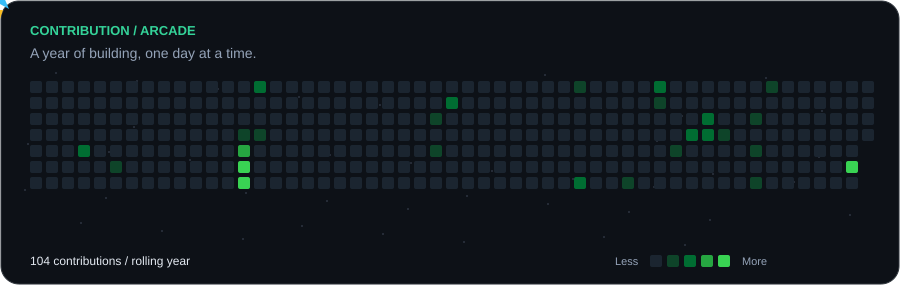

<picture>
  <source media="(prefers-color-scheme: dark)" srcset="./assets/profile-dark.svg?v=portrait">
  
</picture>

  <a href="https://www.linkedin.com/in/jawad-el-kharrati/">LinkedIn</a> ·
  <a href="https://github.com/jawad-elkharrati?tab=repositories">Repositories</a> ·
  <a href="#selected-projects">Selected projects</a>

### `$ github --stats`

Updated daily from GitHub. Repository totals exclude forks. Contributions cover the rolling year; language shares describe code volume, not proficiency.

### `$ ls projects/`

| Project | What it does | Focus |
| :--- | :--- | :--- |
| **[AI QA Project Copilot](https://github.com/jawad-elkharrati/ai-qa-project-copilot)** | Turns project evidence into explainable QA risks, reports and recommendations. | AI agents · RAG · Python |
| **[GeoAI · Rabat](https://github.com/jawad-elkharrati/geoai-rabat-thermal-forecasting)** | Maps and forecasts land surface temperature using satellite and weather data. | Geospatial ML · Remote sensing |
| **[Moroccan Constitution Q&A](https://github.com/jawad-elkharrati/MoroccanConstitution-QA-RAG)** | An interactive question-answering system grounded in the Moroccan Constitution. | NLP · RAG |
| **[VehicleSpeed](https://github.com/jawad-elkharrati/VehicleSpeed)** | A computer vision project for vehicle speed detection. | Python · OpenCV |
| **[Local CMS MCP Sandbox](https://github.com/jawad-elkharrati/local-cms-mcp-sandbox)** | A local MCP sandbox backed by FastAPI, PostgreSQL and MinIO. | APIs · Data infrastructure |
| **[Hotel Management](https://github.com/jawad-elkharrati/Hotel-management-mvc-java)** | A desktop application for managing hotel operations. | Java · Swing · MVC |

### `$ git log --graph`

Tiles show actual GitHub contribution activity. The spaceship animation is decorative.

About me · text version

I am **Jawad EL KHARRATI**, a fourth-year engineering student on a double-degree pathway between **Polytech Nancy (IA2R / SIA)** and **ENSA Oujda (Data Science & Cloud Computing)**.

I build projects around machine learning, retrieval-augmented generation, AI-assisted quality assurance, geospatial forecasting and computer vision.

**Toolbox:** Python, Java, SQL, JavaScript, C · Pandas, NumPy, scikit-learn, OpenCV, Hugging Face, FAISS · FastAPI, Streamlit, PostgreSQL, MySQL, Docker, Git.

**Looking for an engineering internship in Data / AI / ML.** [Let's connect on LinkedIn](https://www.linkedin.com/in/jawad-el-kharrati/).

Terminal-style presentation inspired by [Andrew6rant](https://github.com/Andrew6rant/Andrew6rant). Built around my own projects and GitHub data.
